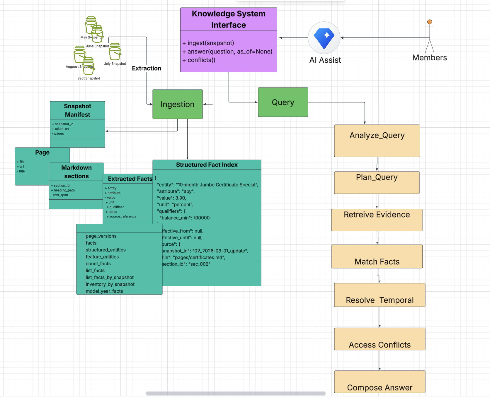
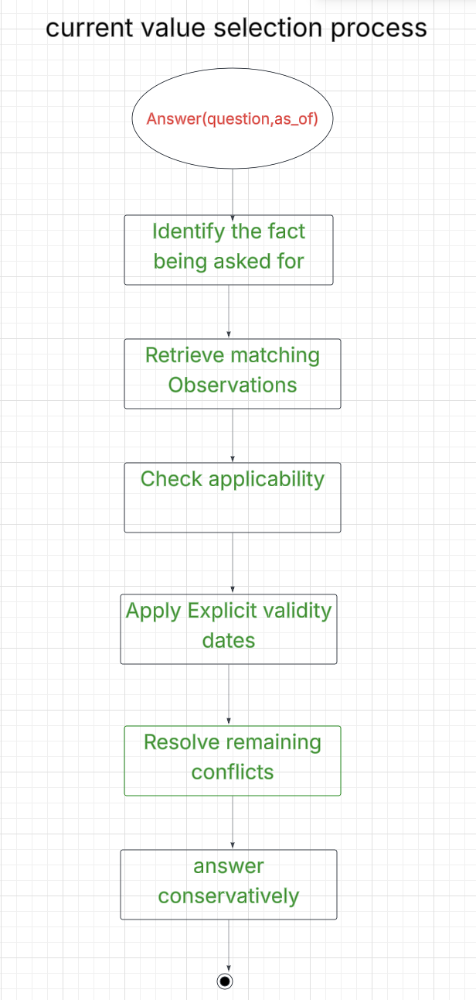

# What was built
  A system that reads the snapshots in date order and answers like a careful
human expert would: with the current value, the right tier, a source, and an honest "I don't know"
when the site doesn't say.

# Architecture
  Ingestion extracts structured fact, entities, attributes, values, units, tiers, qualifiers, dates, and source references
 from snapshots. It keeps all observations, including old and conflicting ones.
  
  Query builds answer using analyze_query → plan_query → retrieve_evidence → match_facts → temporal and conflict resolution.
And return the resolved value, its qualifiers, and citation—or I don't know.

  

# how decide what's current, and which API keys it needs.
The solution is designed around one important principle:
  The newest value is not automatically the correct value. It must be the newest applicable and supported value for the entity, attribute, and qualifiers in the question.

  

The current-value selection process is:
## Identify the fact being asked for 
Extract the entity, attribute, and qualifiers. For example: a particular mortgage product, its interest rate (not APR), for a specified loan type and amount.
## Retrieve matching observations
Search the structured fact index across all snapshots, including older pages that may still contain useful historical evidence.
## Check applicability
Match the requested product, balance, term, loan amount, customer type, location, and other qualifiers. A rate for a different tier is not a conflicting value.
## Apply explicit validity dates
Use effective dates and expiration dates when the source provides them. Exclude evidence that is explicitly expired or not yet effective for the question's date.
## Resolve remaining conflicts
Compare evidence for the same fact and same qualifiers, considering source authority, explicit dates, content status, agreement across sources, and snapshot recency.
## Answer conservatively
Return the selected value with its qualifiers and source. If the evidence cannot support a reliable choice, return I don't know.